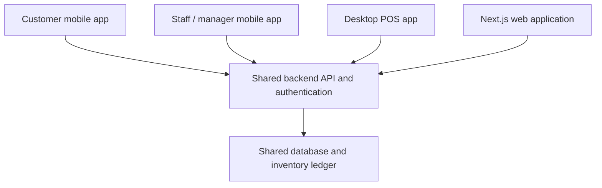

# Phase 1 application foundation

Golden Rose Perfume is one application for one perfume business. The public store, customer accounts and business workspace use the existing Next.js app. Authentication is not configured: all forms are UI previews, do not send credentials, do not create accounts or sessions, and do not protect the workspace.

## Interface structure

- Public storefront: existing black-and-gold homepage, shop, product pages, cart and checkout are retained.
- Customer authentication: `/account/login`, `/account/register`, `/account/forgot-password` use black-and-gold styling with the original logo.
- Customer profile: `/account`, `/account/orders`, `/account/settings` keep their original URLs and content. Their existing layout and pages are organized under `app/account/(profile)/` so sign-in screens do not inherit profile navigation.
- Staff access: `/staff/login` and `/staff/accept-invite` use a separate professional staff presentation. `/staff/sign-in` remains as a compatibility redirect to `/staff/login`.
- Workspace: existing overview and module previews are retained, with a new `/workspace/expenses` preview and sidebar entry. POS, Products, Inventory, Orders, Customers/CRM, Suppliers, Purchasing, Invoices, Reports, Staff, AI Assistant and Settings remain available. Existing Audit Log access is preserved.

Five pages own their headings, copy and navigation. One shared `src/components/auth-form.tsx` handles repeated inputs, password visibility, local validation and explicit preview notices. Customer form styling lives in `app/account/page.css`. Staff-specific styling lives in `app/staff/page.css` and imports the shared form styles. No styles were added to `globals.css`, the homepage CSS or business workspace styles.

## Planned identity and roles

`src/domain/types.ts` contains the canonical `ROLES` list and `Role` type:

| Role | Intended work |
| --- | --- |
| owner | Business administration and all authorized modules |
| manager | Daily operations, team oversight and reports |
| cashier | POS, sales, invoices and customer service |
| inventory_staff | Products, inventory, receiving, purchasing and suppliers |
| sales_staff | Sales, customers and stock availability |
| accountant | Orders, invoices, expenses, purchasing and financial reports |
| customer | Own profile, preferences and purchases |

`src/domain/permissions.ts` describes planned module visibility and role landing destinations. These functions are UI contracts, not secure authorization. No role is selected in customer registration or staff invitation forms. `PUBLIC_REGISTRATION_ROLE` is fixed to `customer`; the future server must enforce that independently of client inputs.

The earlier prototype names `inventory_clerk` and `fulfillment` were replaced by the requested role vocabulary. No production records or migrations are involved in this foundation.

## Shared application architecture

All clients will use the same product variants, locations, stock movements, order records, customers and permissions. Inventory changes must be validated and recorded by the shared backend rather than independently maintained in each app. Native apps will reuse domain contracts and business rules; platform interfaces can differ.

The desktop POS must eventually support USB barcode scanners (including keyboard-wedge input), native receipt printing and synchronized inventory. Printer integration belongs in an appropriate native device adapter. Sales, receipts, reservations, returns and stock changes require server transactions and idempotency to prevent duplicate or conflicting movements. Any future offline POS queue needs an explicit reconciliation policy before implementation.

No mobile app, desktop project, backend service, database, migration, payment integration or live AI was created in this phase.

## Backend requirements before real access

1. Select and configure a real authentication provider or server identity implementation. Verify sessions on the server for account and workspace access; use appropriate native-client session handling later.
2. Implement customer registration so the server always creates only `customer` accounts and rejects attempts to assign staff roles. Add email verification and account recovery with expiring, single-use tokens.
3. Implement invitation creation with authorized owner/manager checks and role-assignment limits. Validate the invitation recipient, expiry, assigned role and single-use status atomically on acceptance. Never trust a role or email merely supplied by the browser.
4. Enforce module and record permissions on every protected page, API and mutation. Customer queries must be restricted to the signed-in customer's own records. The current public workspace preview is not protected.
5. Add secure session expiry/revocation, credential handling, request throttling, abuse protection and authentication audit records. The frontend preview currently stores no credentials and sends no authentication requests.
6. Create the shared business data model and inventory transaction rules only in a separately approved backend phase.

## Verification

The production build and standalone TypeScript check passed. Thirteen local validation and planned-permission tests passed, including customer/module separation, finance visibility, email format, new-password length, confirmation matching and required invitation codes. These tests do not verify real authentication because no authentication backend exists.

Production HTTP and source-preservation results are appended after the final check.

Production verification: 28 routes returned HTTP 200 with headings, including the homepage, existing shop/cart/checkout/account pages, all five authentication screens, workspace overview and every registered workspace module. Checks confirmed rendered email/password fields, show-password controls, explicit preview status, no role-selection field, separate profile/workspace navigation and served authentication CSS. The existing `/staff/sign-in` destination and new Expenses sidebar link were verified. The build reported no route conflicts.

SHA-256 comparison confirmed that the homepage TSX/CSS, slideshow, global stylesheet, existing shared business stylesheet, package files and Next.js configuration are unchanged from the start of this phase. `git diff --check` passed. No dependencies were installed.

The preview's inputs and submission controls remain disabled until JavaScript mounts the form, preventing a non-JavaScript default credential submission. After mounting, submission is intercepted for local validation only. Interactive browser testing was not available; the checks above cover production server responses and the pure validation logic.

Known build warning: Next.js ignores an unrelated `C:/Users/HP/package-lock.json` outside this Git repository. It does not block the build.

## Files in this phase

Added:
- `app/account/login/page.tsx`
- `app/account/register/page.tsx`
- `app/account/forgot-password/page.tsx`
- `app/account/page.css`
- `app/staff/login/page.tsx`
- `app/staff/accept-invite/page.tsx`
- `app/staff/page.css`
- `src/components/auth-form.tsx`
- `src/components/auth-form.test.ts`
- `docs/PHASE_1_FOUNDATION.md`

Moved existing account files into `app/account/(profile)/`: `layout.tsx`, `page.tsx`, `orders/page.tsx`, `settings/page.tsx`. Only the overview page content was extended with customer login/registration links; all URLs are preserved.

Updated existing foundation files:
- `app/staff/sign-in/page.tsx`
- `src/domain/types.ts`
- `src/domain/permissions.ts`
- `src/domain/permissions.test.ts`
- `src/domain/modules.ts`
- `src/components/workspace-sidebar.tsx`
- `src/lib/module-content.ts`
